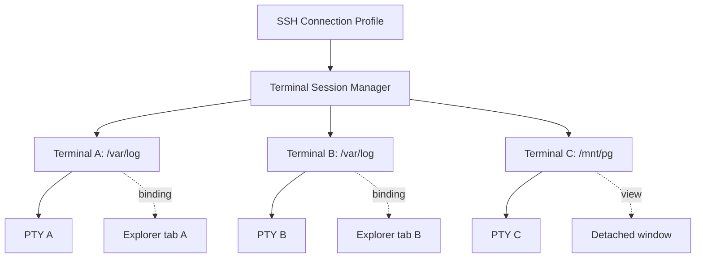
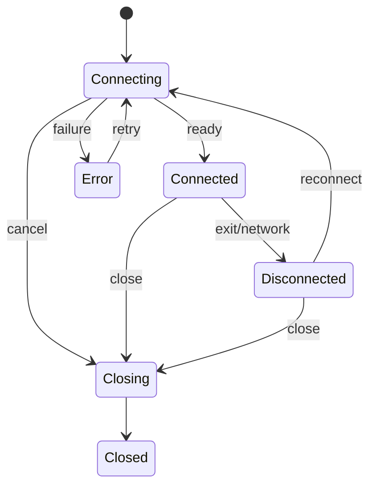

# UltraReview — Terminal subsystem (2026-11-25)

Version 0.2.18. Audited revision: [937631a989bbb712e77b74df56934ad5e3b6de15](https://github.com/Artemedi/FileExplorer/commit/937631a989bbb712e77b74df56934ad5e3b6de15).
Method: local `~/.agents/skills/ultrareview/SKILL.md` and audit-contract.md, sequential / NOT_INDEPENDENT. Review in Russian; source unchanged during audit.

## 1. Архитектурный вердикт

Терминал сейчас производен от SSH endpoint и жизненного цикла панели проводника. Rust уже поддерживает уникальные PTY ID и отдельные рабочие потоки; ограничение числа сессий главным образом находится в React. Замена xterm.js/ssh2 не требуется. Независимая идентичность терминала, корректный lifecycle, явная привязка и отделение представления от транспорта — минимальная стратегия.

## 2. Findings

Все findings присутствуют в HEAD (PRE_EXISTING; commit introducing defect не устанавливался). P1/P2 оценивают риск, не утверждают эксплуатацию или установленную причину каждого физического обрыва. Ссылки ниже относятся к зафиксированному SHA.

| ID | Severity | Evidence | Classification / impact |
|---|---|---|---|
| TERM-001 | P1 | Terminal.jsx:114–115,538–575,587–624; ssh_commands.rs:337–340 | CONFIRMED_DYNAMIC / SYNTHETIC_REPRODUCED: ключ user@host:port, один терминал для всех каталогов endpoint; backend уникален |
| TERM-002 | P1 | Terminal.jsx:499–517,626–656 | CONFIRMED_DYNAMIC / SYNTHETIC_REPRODUCED: Set autoPtyAttempted не сбрасывается при exit, блокирует повторную авто-попытку |
| TERM-003 | P1 | MainLayout.jsx:1380–1385; Terminal.jsx:523–536 | CONFIRMED_STATIC: hide размонтирует Terminal, cleanup закрывает все PTY, foreground process может завершиться |
| TERM-004 | P1 | ssh_commands.rs:386–478 | CONFIRMED_STATIC: допустим порядок ready→worker remove→async insert, stale sender; раннее exit может опередить frontend |
| TERM-005 | P1 | ssh_commands.rs:386–399,482–489 | CONFIRMED_STATIC: неблокирующий write_all/flush игнорируют ошибки и частичную запись; IPC success означает enqueue, не доставку; фактическая потеря не воспроизведена |
| TERM-006 | P2 | Terminal.jsx:640–655,1807–1818,1859–1875 | CONFIRMED_STATIC: закрытие вкладки/размонтирование до async start resolution оставляет PTY без владельца; конкурентные старты |
| TERM-007 | P2 | Terminal.jsx:327–377,471–496,587–624; TabManager.jsx:264–316 | CONFIRMED_STATIC: глобальные sync flags/timers; async load может закончиться после смены вкладки; same-path tab switch не меняет currentPath |
| TERM-008 | P2 | Terminal.jsx:408–433; ssh_commands.rs:387–435,465–478 | CONFIRMED_STATIC: вывод до регистрации frontend/контроллера не имеет надёжного буфера; stripped history не сохраняет VT state |
| TERM-009 | P2 | ssh_commands.rs:393–462 | STATIC_ONLY: нет явного keepalive в PTY loop, слабая дифференциация причин; реальная причина сетевых обрывов HYPOTHESIS |
| TERM-010 | P2 | Terminal.jsx:1902–1907; ssh_commands.rs:540–636 | CONFIRMED_STATIC: Ext SSH не принимает cwd; отдельный native OS terminal не принадлежит менеджеру, Windows/Linux only |
| TERM-011 | P3 | Terminal.jsx:640; SftpProvider.jsx:598–606 | CONFIRMED_STATIC: cols/rows игнорируются provider, сейчас компенсируются Rust defaults и resize |

### Доказательства и контрпримеры

TERM-001: `getSshTabId = conn => ssh:user@host:port`; ensureAndSelectSshTab обновляет существующий tab, а не создаёт новый. Открытие /a, /a, /b на одном endpoint оставляет один tab. Rust SSH_PTY_COUNTER уже уникален. Разделить connectionId и terminalId; cwd не ключ идентичности.

TERM-002: effect добавляет tab.id в Set до старта. exit выставляет ptySessionId=null, но Set остаётся. Повторный effect не запускает PTY. Ручной PTY возможен; не вводить бесконечный автоматический reconnect и не повторять старые команды. Явные состояния connecting/connected/disconnected/closing/closed/error и Reconnect.

TERM-003: MainLayout условно монтирует Terminal; unmount cleanup вызывает ssh_close_pty для всех. Hide/show должен сохранять PTY, history и xterm; явное закрытие завершает только выбранный PTY. Закрытие приложения — controlled cleanup.

TERM-004: ready отправляется worker до регистрации sender вызывающим async command; при быстром exit remove может предшествовать insert. Регистрация до запуска событий; cleanup при ошибках; frontend handshake должен обработать ранний exit/output. Не считать эту гонку доказанной причиной наблюдаемого сетевого сбоя.

TERM-005: nonblocking write_all может частично передать буфер и вернуть WouldBlock; результат игнорируется. Ограниченная очередь, write с offset, retry только оставшихся байт, fatal error→disconnected; не переигрывать весь буфер. Ошибки IPC не должны молча проглатываться. Fairness чтения/записи и backpressure.

TERM-006: поздний результат старта должен либо принадлежать живому поколению logical session, либо закрываться. Единый pending-start guard, idempotent close, cleanup on unmount. Тест close during connecting/double click.

TERM-007: отделить explorerTabId от currentPath, выбрать явную пару; хранить sync state per session/binding, generation check после await. Не отправлять cd при busy shell. Сохранить OSC 133 guard; duplicate по умолчанию independent.

TERM-008: буферизовать ограниченный raw VT output до attach, обеспечить порядок событий, snapshot/replay для detach; не считать plain text history эквивалентом VT state.

TERM-009: keepalive, типизированная причина завершения, диагностические события без secrets, время последнего IO. Не связывать отсутствие keepalive с конкретным обрывом без интеграционных данных.

TERM-010: native external SSH остаётся отдельной функцией. Передать cwd безопасно (без shell injection), проверить auth/known-hosts и платформенные ограничения; не выдавать внешний shell за управляемую сессию. Tauri capabilities/default.json сейчас только main. Для отдельного управляемого окна нужны ограниченные permissions, адресная маршрутизация событий и ownership checks.

TERM-011: передать cols/rows через startSshPty, проверить IPC и размеры.

## 3. Целевая архитектура



ConnectionId — профиль/auth; explorerTabId — вкладка проводника; terminalId — логическая сессия; ptySessionId — экземпляр shell. TerminalSession: id, connectionId, ptySessionId|null, explorerTabId|null, workingDir, status, syncMode (none/follow-explorer/bidirectional), exitReason. Не мигрировать весь проект на TS. Generation guard для async операций; reconnect сохраняет logical id/CWD/доступный вывод, создаёт новый PTY, не повторяет команды.



UX: New SSH Terminal, Duplicate Terminal (новый shell с тем же профилем/CWD, без копирования privileged state), Split Terminal (два независимых shell), Detach to Window (тот же PTY, не новый SSH), Attach to Explorer, Unlink, Reconnect, Hide Terminal (без завершения), Ext SSH (native OS). Mirror — одно PTY в нескольких views, requires input/resize arbitration; отложить (YAGNI). Новый duplicate независим по умолчанию; существующие настройки sync сохранять. Для detach использовать отдельное Tauri WebviewWindow с backend-owned session, bounded replay/snapshot и single input owner. Не расширять capabilities без необходимости.

### Tradeoffs

Unique ID/metadata — минимально; отдельный SSH connection/thread/crypto — линейные затраты; xterm scrollback/WebGL — умеренные; bounded queues — контролируемая память; keepalive — небольшой сетевой overhead; WebView window — существенные ресурсы; Mirror — высокая сложность. Existing worker polls WouldBlock с 15 ms sleep; не менять runtime до замеров. Rollback: отдельные stage commits, без миграции пользовательских данных, не ломать старый Ext SSH.

## 4. Roadmap

| Stage | Scope | Target files | Gate |
|---|---|---|---|
| TERM-R1 Lifecycle Reliability | hide persistence, reconnect, register/exit race, partial writes, cancellation, initial output | MainLayout.jsx, Terminal.jsx, ssh_commands.rs, XtermSshView.jsx/tests as needed | T03–T10,T15,T17,T18 |
| TERM-R2 Independent Sessions | separate IDs, New SSH, Duplicate | Terminal.jsx, SftpProvider.jsx, minimal session state, tests | T01,T02,T12,T16 |
| TERM-R3 Explorer Binding | explicit explorerTabId, per-binding sync, attach/unlink | TabManager.jsx, Terminal.jsx, MainLayout.jsx/navigation, tests | T11 and existing OSC tests |
| TERM-R4 Detached Terminal | independent Tauri window, same PTY, attach handoff | window management, capabilities, XtermSshView.jsx, session manager, tests | T13,T14,T17 |
| TERM-R5 Operational Hardening | keepalive, diagnostics, resource/platform tests, Ext SSH cwd | ssh_commands.rs, SSH config, CI/tests | T05,T10,T14,T15,T17 |

Do not merge next stage before gate is assessed. A blocked environment is not PASS. Prefer local isolated SSH fixture, no real production systems. Changes only related to the current stage.

## 5. Regression acceptance

| ID | Scenario | Expected |
|---|---|---|
| T01 | Same CWD twice | distinct PTY IDs |
| T02 | Three sessions same endpoint | independent shells |
| T03 | Hide panel | all PTYs stay alive |
| T04 | Show panel | output and state preserved |
| T05 | Network interruption | Disconnected |
| T06 | Reconnect | new PTY, same logical tab |
| T07 | Close while Connecting | no orphan |
| T08 | Double connect | one pending start per tab |
| T09 | Exit before registration | no stale sender |
| T10 | Partial nonblocking write | no lost/duplicated bytes |
| T11 | Fast explorer switch | no cross-navigation |
| T12 | Duplicate during command | original process unchanged |
| T13 | Detach during command | same PTY preserved |
| T14 | mc/htop/vim | correct input/resize |
| T15 | 10 connect/close cycles | no thread/session growth |
| T16 | Duplicate after sudo -i | normal auth, no inherited elevated state |
| T17 | App exit | controlled resource release |
| T18 | Event from stale PTY | cannot affect new generation |

## 6. Baseline verification

Remote Bazzite isolated clean checkout: Node 22.23.2, npm 12.2.3, Cargo 1.97.1. 257 tracked files, 16 target files investigated (not exhaustive line review), 241 not equivalently reviewed. Scope: terminal components/provider/navigation/backend/window permissions/test contracts; excluded unrelated assets, packaging, search, filesystem subsystems from detailed inspection. No local WIP covered; pinned public HEAD. No independent reviewers. No live SSH, production access, installations, source changes. Security/multi-window permissions and full project review incomplete.

Executed synthetic Node harness extracted actual ensureAndSelectSshTab and auto-start effect with stub setters, no real React/SSH:
```
T1 actual ensureAndSelectSshTab: 3 opens, 1 tab; cwd=/b
T2 actual auto-start effect: after simulated exit, starts=1; sid=null
synthetic_exit=0
```
Two defect reproductions, four assertion calls; PASS means defect reproduced, not acceptance. Static counterexamples for others; physical network interruption unverified.

| Check | Result | Exit |
|---|---|---|
| git rev-parse HEAD | PASS | 0 |
| synthetic Node harness | PASS | 0 |
| node --test tests/codebase_audit.test.mjs | BLOCKED_ENV (@tauri-apps/api missing; no assertions executed) | 1 |
| Vitest | BLOCKED_ENV (node_modules absent) | not run |
| build / typecheck / Cargo tests | NOT_RUN | — |
| git diff --check | PASS | 0 |
| git status --porcelain | clean | — |

Coverage architecture/identity/static lifecycle COMPLETE within target; security/cross-window, integration/performance, rest of repo INCOMPLETE. Overall Audit execution INCOMPLETE; terminal acceptance FAIL against independent sessions and hide persistence requirements; test execution coverage INCOMPLETE. Not deployment certification. No P0 established.

## 7. Final recommendation

Implement R1 before adding multiple sessions; preserve xterm.js, ssh2 and SFTP. Separate logical identity, lifetime and view. Then R2–R5 sequentially. Review evidence is baseline only; update implementation evidence in separate stage notes, not retroactively label untested results as PASS.
